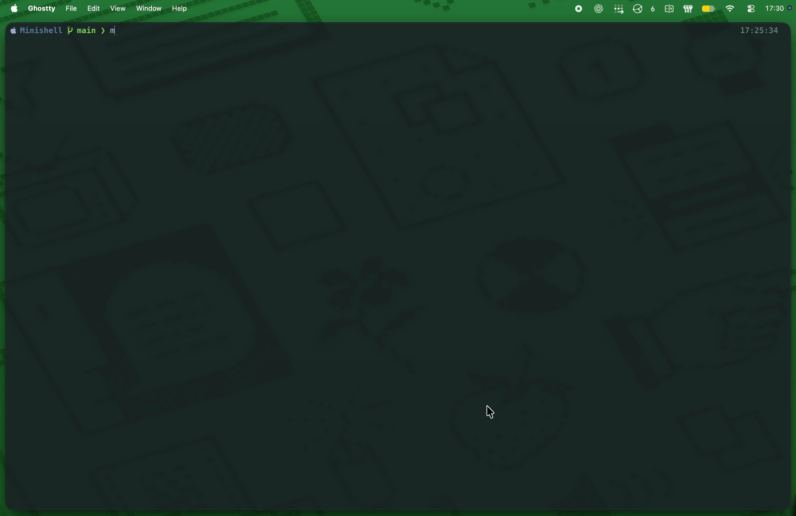
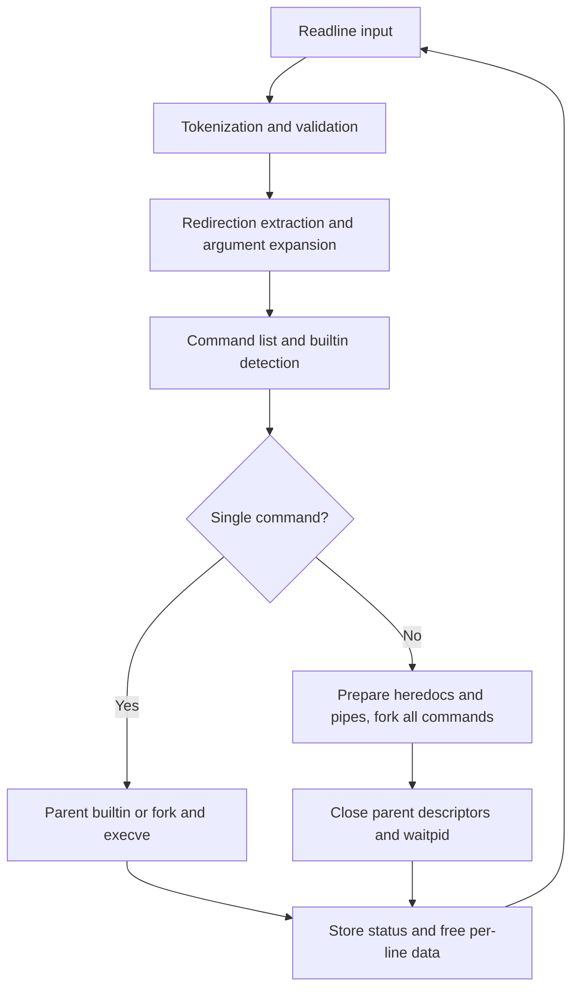
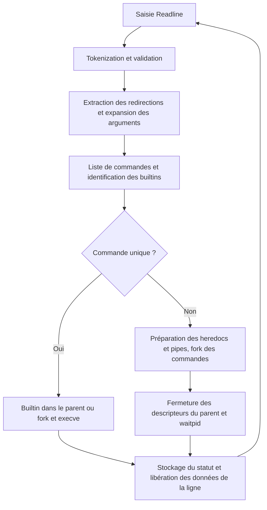

*Developed as part of the École 42 Paris curriculum.*

# Minishell

**A small interactive shell in C: from typed input to Unix processes, pipelines and file descriptors.**

[English](#english) | [Français](#francais)


---

<a id="english"></a>
## English

[Project Context](#en-context) · [Overview](#en-overview) · [Features](#en-features) · [Engineering Highlights](#en-engineering) · [Architecture](#en-architecture) · [Getting Started](#en-start) · [Usage Examples](#en-examples)

<a id="en-context"></a>
### 1. Project Context

Minishell belongs to the École 42 Paris common core curriculum, a project-based, peer-learning programme. Its learning objectives include C data structures, Unix process control, descriptor management, parsing, memory ownership and collaborative debugging.

**I developed this Minishell entirely on my own, without generative AI assistance**, from command parsing to Unix process execution. Normally a two-person project, it became an independent development effort when my original teammate was unable to participate due to illness. I implemented the mandatory scope only, choosing to focus on it rather than the initially planned bonuses while working alone.

For submission, I teamed up with another student who had already completed their own Minishell; they did not contribute to the code in this repository.

<a id="en-overview"></a>
### 2. Overview

Minishell implements a focused subset of shell behaviour rather than delegating command lines to Bash. It reads input with GNU Readline, tokenizes and expands arguments, builds a command representation, and executes builtins or external programs.

The engineering challenge is coordinating **persistent shell state**, **concurrent child processes** and **resource lifetimes** in C. The repository makes these responsibilities visible through separate parsing, execution, environment and signal modules.

<a id="en-features"></a>
### 3. Features

| Area | Implemented scope |
|---|---|
| Interactive input | Readline prompt, line editing, in-session command history, EOF exit |
| Parsing & expansion | Words, separately quoted arguments, `$NAME` and `$?`; single-quoted arguments remain literal |
| Command execution | `PATH` lookup, explicit relative/absolute executable paths, `fork`, `execve`, `waitpid` |
| Pipelines & files | Multi-command `\|` pipelines; `<`, `>`, `>>` redirections; basic `<<` heredocs |
| Builtins | `echo` with `-n`, `cd`, `pwd`, `export`, `unset`, `env`, `exit` |
| Shell state | Private environment copy; `cd` updates `PWD`/`OLDPWD`; last command status through `$?` |
| Signals | Prompt-level `SIGINT` handler, ignored `SIGQUIT`, terminal control-character echo disabled |

<a id="en-engineering"></a>
### 4. Engineering Highlights

#### Keeping lexical context until expansion

The tokenizer distinguishes `T_WORD`, `T_SQWORD` and `T_DQWORD`. During command construction, `extract_cmd_args()` expands unquoted and double-quoted tokens, but duplicates single-quoted tokens unchanged. This is how `echo "$HOME"` and `echo '$HOME'` take different paths without involving another shell. Redirection operands are extracted separately and marked `T_SKIP`, so they do not become command arguments.

Sources: [token types](inc/tokenizer.h), [tokenization and syntax checks](src/parsing/tokenizer.c), [command construction](src/parsing/ast.c), [variable expansion](src/parsing/ast_expand.c). This token model does not fully support mixed quoted/unquoted fragments within one argument.

#### Choosing the execution context for stateful builtins

A standalone builtin runs in the parent process: otherwise `cd` or `export` would change only a temporary child. For this path, the executor saves standard input/output with `dup()`, applies redirections and restores the descriptors after the builtin. In a pipeline, every command—including a builtin—runs in a child, isolating its state changes from the interactive shell.

Sources: [single-command dispatch](src/exec/exec.c), [descriptor restoration and external execution](src/exec/exec_utility.c), [pipeline child execution](src/exec/exec_pipeline.c).

#### Launching pipelines before waiting

For **N commands**, `create_pipes()` allocates **N − 1 pipes**. Each child connects the adjacent pipe ends to standard input/output with `dup2()`, closes the original pipe descriptors, then applies its own redirections. All commands are forked before the parent closes its pipe copies and calls `waitpid()`. This allows producers and consumers to run concurrently, rather than waiting for a producer whose pipe may be full. For normal exits, the pipeline status comes from its last command.

Sources: [pipeline orchestration](src/exec/exec.c), [fork/wait lifecycle](src/exec/exec_pipeline.c), [pipe indexing and closure](src/exec/exec_pipeline_utility.c).

#### Separating redirection metadata from descriptor operations

Each command owns an ordered redirection list (`t_redir`). Output handling creates or truncates the listed output files, then selects the final output destination; input handling selects the last input redirection. Pipeline heredocs are collected in the parent before forking and passed through pipe read descriptors, with dedicated helpers to close unrelated heredoc descriptors in children.

Sources: [command and redirection structures](inc/ast.h), [file descriptor operations](src/exec/exec_redir.c), [redirection selection](src/exec/exec_redir_utility.c), [heredoc collection](src/exec/exec_heredoc.c).

#### Making ownership explicit in C

The shell duplicates the inherited environment instead of modifying the original `envp`. Adding an environment entry reallocates the pointer array while retaining existing strings; removing one constructs a reduced copy before freeing the previous environment. After each command line, the main loop frees tokens, command arguments, redirections and input; the environment persists until shell shutdown.

Sources: [environment ownership](src/envp/envp.c), [insertion](src/envp/set_env_var_utility.c), [removal](src/envp/unset_env_var_utility.c), [per-line cleanup](src/minishell.c), [command cleanup](src/parsing/ast_cmd.c).

<a id="en-architecture"></a>
### 5. Architecture

Despite the `ast` naming, the parsed representation is a **linked list of commands**, each containing an argument array and a linked list of redirections—not a general expression tree.

I initially planned an AST to support the bonus features. When I chose to focus on the mandatory scope while developing alone, the command list was enough, but the `ast` name stayed. The tree ambitions were there; in the end, I kept just the trunk. 🌳



The diagram shows the normal processing loop; EOF or `exit` ends it. Single external commands are also waited for before returning to the prompt.

```text
inc/            Shared types and module interfaces
src/main.c      Shell initialization and final environment cleanup
src/minishell.c Read–parse–execute loop and per-line cleanup
src/parsing/    Tokens, validation, expansion, command/redirection lists
src/exec/       Executable lookup, process lifecycle, pipes, redirections, heredocs
src/built_in/   Seven builtin commands and export display helper
src/envp/       Environment copying, lookup, insertion, update and removal
src/signals/    Signal handlers and terminal configuration
src/libft/      Local string, character and conversion helpers
src/debug/      Token and command-list inspection helpers
```

<a id="en-start"></a>
### 6. Getting Started

**Requirements:** a Unix-like environment, `cc`, Make, GNU Readline headers and library. The [Makefile](Makefile) contains Linux and macOS branches and builds with `-Wall -Wextra -Werror`.

Install the dependencies for your system, for example:

```bash
# Debian / Ubuntu
sudo apt install build-essential libreadline-dev

# macOS: Xcode Command Line Tools + Homebrew
xcode-select --install
brew install readline
```

From the repository root:

```bash
make            # Build ./minishell
./minishell     # Open the interactive prompt
```

```bash
make clean      # Remove obj/
make fclean     # Also remove the executable
make re         # Clean everything, then rebuild
```

On macOS, the Makefile uses `/opt/homebrew/opt/readline` at link time, but does not pass its header path to object compilation. If Readline headers are not found, supply the include path without editing the Makefile:

```bash
make INCLUDES="-I./inc -I$(brew --prefix readline)/include" \
     RLFLAGS="-L$(brew --prefix readline)/lib -lreadline"
```

The default build was verified on macOS with Readline available at the expected path. There is no `-c` command mode: launch the shell, then type commands at its prompt.

<a id="en-examples"></a>
### 7. Usage Examples

Enter each line inside Minishell. `printf`, `wc`, `cat` and `false` below are external programs and must be available through `PATH`.

**Environment and quote context** — the first `echo` expands the variable; the second prints `$DEMO` literally.

```bash
export DEMO=Minishell
echo "$DEMO"
echo '$DEMO'
unset DEMO
```

**Concurrent pipeline** — sends two words to `wc`, which reports a count of 2.

```bash
printf "alpha beta" | wc -w
```

**File redirections** — creates `demo.txt` in the current directory, appends content, then reads it. These examples use an external writer to avoid the builtin buffering limitation.

```bash
printf "first line" > demo.txt
printf " second line" >> demo.txt
cat < demo.txt
```

**Heredoc feeding a pipeline** — enter `END` on its own line to finish input; `wc` reports one line.

```bash
cat << END | wc -l
hello
END
```

**Persistent directory and exit status** — `pwd` prints `/`; `echo $?` prints `1`. An argument-free `exit` returns the most recent status (here, the successful `echo`).

```bash
cd /
pwd
false
echo $?
exit
```

---

<a id="francais"></a>
## Français

[Contexte du projet](#fr-contexte) · [Présentation](#fr-presentation) · [Fonctionnalités](#fr-fonctionnalites) · [Points techniques](#fr-technique) · [Architecture](#fr-architecture) · [Installation et lancement](#fr-installation) · [Exemples](#fr-exemples)

<a id="fr-contexte"></a>
### 1. Contexte du projet

Minishell s'inscrit dans le tronc commun de l'École 42 Paris, une formation par projets et apprentissage entre pairs. Ses objectifs pédagogiques comprennent les structures de données en C, le contrôle des processus Unix, la gestion des descripteurs, le parsing, l'ownership mémoire et le débogage collaboratif.

**J'ai développé l'intégralité de ce Minishell seul, sans recours à l'IA générative**, du parsing des commandes à l'exécution des processus Unix. Normalement réalisé en binôme, ce projet est devenu un développement en autonomie lorsque mon binôme initial, malade, n'a pas pu y participer. J'ai réalisé uniquement la partie obligatoire, en choisissant de m'y concentrer plutôt que de développer les bonus initialement envisagés puisque je travaillais seul.

Pour le rendu, j'ai fait équipe avec un autre étudiant qui avait déjà terminé son propre Minishell ; il n'a pas contribué au code de ce repository.

<a id="fr-presentation"></a>
### 2. Présentation

Minishell implémente un sous-ensemble ciblé du comportement d'un shell, sans déléguer les lignes de commande à Bash. Il lit les entrées avec GNU Readline, découpe et développe les arguments, construit une représentation des commandes, puis exécute les builtins ou les programmes externes.

La difficulté technique consiste à coordonner **l'état persistant du shell**, **des processus enfants concurrents** et **la durée de vie des ressources** en C. Le dépôt rend ces responsabilités visibles grâce à des modules distincts pour le parsing, l'exécution, l'environnement et les signaux.

<a id="fr-fonctionnalites"></a>
### 3. Fonctionnalités

| Domaine | Périmètre implémenté |
|---|---|
| Saisie interactive | Prompt Readline, édition de ligne, historique de session, sortie sur EOF |
| Parsing et expansion | Mots, arguments entre quotes séparés, `$NAME` et `$?` ; arguments entre quotes simples conservés littéralement |
| Exécution | Recherche dans `PATH`, chemins exécutables relatifs/absolus explicites, `fork`, `execve`, `waitpid` |
| Pipelines et fichiers | Pipelines multicommandes avec `\|` ; redirections `<`, `>`, `>>` ; heredocs `<<` élémentaires |
| Builtins | `echo` avec `-n`, `cd`, `pwd`, `export`, `unset`, `env`, `exit` |
| État du shell | Copie privée de l'environnement ; mise à jour de `PWD`/`OLDPWD` par `cd` ; dernier code de retour via `$?` |
| Signaux | Handler de `SIGINT` au prompt, `SIGQUIT` ignoré, écho des caractères de contrôle désactivé dans le terminal |

<a id="fr-technique"></a>
### 4. Points techniques

#### Conserver le contexte lexical jusqu'à l'expansion

Le tokenizer distingue `T_WORD`, `T_SQWORD` et `T_DQWORD`. Lors de la construction des commandes, `extract_cmd_args()` développe les tokens non quotés ou entre quotes doubles, mais duplique tels quels ceux entre quotes simples. Ainsi, `echo "$HOME"` et `echo '$HOME'` suivent des traitements différents sans faire intervenir un autre shell. Les opérandes de redirection sont extraits séparément et marqués `T_SKIP` pour ne pas devenir des arguments de commande.

Sources : [types de tokens](inc/tokenizer.h), [tokenization et vérifications syntaxiques](src/parsing/tokenizer.c), [construction des commandes](src/parsing/ast.c), [expansion des variables](src/parsing/ast_expand.c). Ce modèle ne gère pas complètement les fragments quotés et non quotés mélangés dans un même argument.

#### Choisir le contexte d'exécution des builtins qui modifient l'état

Un builtin isolé s'exécute dans le processus parent : sinon, `cd` ou `export` ne modifierait qu'un enfant temporaire. Pour ce chemin, l'exécuteur sauvegarde l'entrée et la sortie standard avec `dup()`, applique les redirections et restaure les descripteurs après le builtin. Dans un pipeline, chaque commande — builtin compris — s'exécute dans un enfant, ce qui isole ses changements d'état du shell interactif.

Sources : [dispatch d'une commande isolée](src/exec/exec.c), [restauration des descripteurs et exécution externe](src/exec/exec_utility.c), [exécution des enfants du pipeline](src/exec/exec_pipeline.c).

#### Lancer les commandes d'un pipeline avant de les attendre

Pour **N commandes**, `create_pipes()` alloue **N − 1 pipes**. Chaque enfant connecte les extrémités des pipes adjacents à son entrée et à sa sortie standard avec `dup2()`, ferme les descripteurs d'origine, puis applique ses propres redirections. Toutes les commandes sont créées par `fork` avant que le parent ferme ses copies des pipes et appelle `waitpid()`. Les producteurs et les consommateurs peuvent ainsi s'exécuter simultanément, sans attendre un producteur dont le pipe pourrait être plein. En cas de terminaison normale, le statut du pipeline provient de sa dernière commande.

Sources : [orchestration du pipeline](src/exec/exec.c), [cycle fork/wait](src/exec/exec_pipeline.c), [indexation et fermeture des pipes](src/exec/exec_pipeline_utility.c).

#### Séparer les métadonnées de redirection des opérations sur les descripteurs

Chaque commande possède une liste ordonnée de redirections (`t_redir`). Le traitement des sorties crée ou tronque les fichiers concernés, puis sélectionne la destination finale ; celui des entrées sélectionne la dernière redirection d'entrée. Les heredocs d'un pipeline sont lus dans le parent avant les `fork`, puis transmis par les descripteurs de lecture de pipes. Des helpers dédiés ferment dans chaque enfant les descripteurs de heredoc appartenant aux autres commandes.

Sources : [structures de commande et de redirection](inc/ast.h), [opérations sur les descripteurs](src/exec/exec_redir.c), [sélection des redirections](src/exec/exec_redir_utility.c), [lecture des heredocs](src/exec/exec_heredoc.c).

#### Rendre l'ownership explicite en C

Le shell duplique l'environnement hérité au lieu de modifier l'`envp` d'origine. L'ajout d'une variable réalloue le tableau de pointeurs tout en conservant les chaînes existantes ; sa suppression construit une copie réduite avant de libérer l'ancien environnement. Après chaque ligne de commande, la boucle principale libère les tokens, les arguments, les redirections et la saisie ; l'environnement subsiste jusqu'à l'arrêt du shell.

Sources : [ownership de l'environnement](src/envp/envp.c), [insertion](src/envp/set_env_var_utility.c), [suppression](src/envp/unset_env_var_utility.c), [nettoyage par ligne](src/minishell.c), [libération des commandes](src/parsing/ast_cmd.c).

<a id="fr-architecture"></a>
### 5. Architecture

Malgré le nom `ast`, la représentation issue du parsing est une **liste chaînée de commandes**, chacune contenant un tableau d'arguments et une liste chaînée de redirections — pas un arbre d'expressions généraliste.

J'avais initialement envisagé un AST pour prendre en charge les bonus. En choisissant de me concentrer sur la partie obligatoire puisque je développais seul, la liste de commandes suffisait, mais le nom `ast` est resté. L'ambition de l'arbre était là ; finalement, j'ai gardé le tronc. 🌳



Le diagramme décrit la boucle normale ; EOF ou `exit` l'interrompt. Une commande externe isolée est également attendue avant le retour au prompt.

```text
inc/            Types partagés et interfaces des modules
src/main.c      Initialisation du shell et libération finale de l'environnement
src/minishell.c Boucle lecture–parsing–exécution et nettoyage par ligne
src/parsing/    Tokens, validation, expansion, listes de commandes/redirections
src/exec/       Recherche des exécutables, processus, pipes, redirections, heredocs
src/built_in/   Sept builtins et helper d'affichage d'export
src/envp/       Copie, recherche, insertion, mise à jour et suppression des variables
src/signals/    Handlers de signaux et configuration du terminal
src/libft/      Fonctions locales de chaînes, caractères et conversions
src/debug/      Helpers d'inspection des tokens et de la liste de commandes
```

<a id="fr-installation"></a>
### 6. Installation et lancement

**Prérequis :** un environnement de type Unix, `cc`, Make, les headers et la bibliothèque GNU Readline. Le [Makefile](Makefile) prévoit des branches Linux et macOS et compile avec `-Wall -Wextra -Werror`.

Installez les dépendances de votre système, par exemple :

```bash
# Debian / Ubuntu
sudo apt install build-essential libreadline-dev

# macOS : Xcode Command Line Tools + Homebrew
xcode-select --install
brew install readline
```

Depuis la racine du dépôt :

```bash
make            # Compiler ./minishell
./minishell     # Ouvrir le prompt interactif
```

```bash
make clean      # Supprimer obj/
make fclean     # Supprimer aussi l'exécutable
make re         # Tout nettoyer, puis recompiler
```

Sur macOS, le Makefile utilise `/opt/homebrew/opt/readline` à l'édition de liens, mais ne transmet pas le chemin des headers à la compilation des objets. Si les headers Readline sont introuvables, fournissez ce chemin sans modifier le Makefile :

```bash
make INCLUDES="-I./inc -I$(brew --prefix readline)/include" \
     RLFLAGS="-L$(brew --prefix readline)/lib -lreadline"
```

La compilation par défaut a été vérifiée sur macOS avec Readline disponible au chemin attendu. Il n'existe pas de mode de commande `-c` : lancez le shell, puis saisissez les commandes au prompt.

<a id="fr-exemples"></a>
### 7. Exemples d'utilisation

Saisissez chaque ligne dans Minishell. Les commandes `printf`, `wc`, `cat` et `false` ci-dessous sont des programmes externes qui doivent être accessibles via `PATH`.

**Environnement et contexte des quotes** — le premier `echo` développe la variable ; le second affiche littéralement `$DEMO`.

```bash
export DEMO=Minishell
echo "$DEMO"
echo '$DEMO'
unset DEMO
```

**Pipeline concurrent** — transmet deux mots à `wc`, qui affiche un compte de 2.

```bash
printf "alpha beta" | wc -w
```

**Redirections de fichiers** — crée `demo.txt` dans le dossier courant, ajoute du contenu, puis le relit. Ces exemples utilisent un programme externe pour l'écriture afin d'éviter la limite de buffering des builtins.

```bash
printf "first line" > demo.txt
printf " second line" >> demo.txt
cat < demo.txt
```

**Heredoc alimentant un pipeline** — saisissez `END` seul sur une ligne pour terminer la saisie ; `wc` compte une ligne.

```bash
cat << END | wc -l
hello
END
```

**Répertoire persistant et code de retour** — `pwd` affiche `/` ; `echo $?` affiche `1`. Sans argument, `exit` renvoie le dernier statut (ici, celui de l'`echo` réussi).

```bash
cd /
pwd
false
echo $?
exit
```
