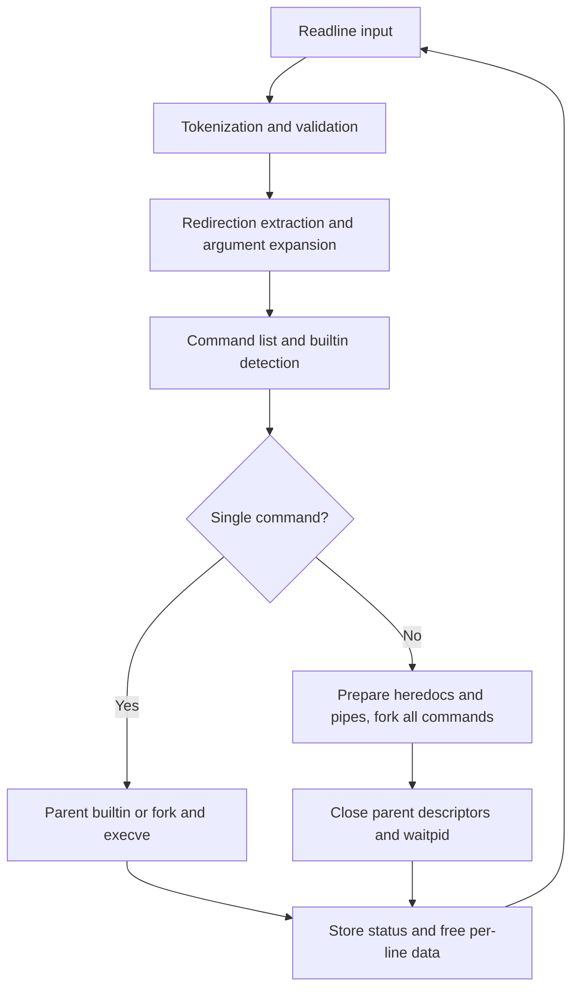
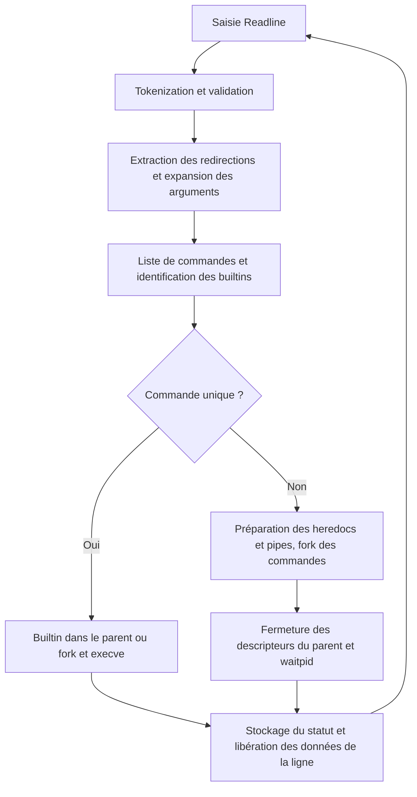

*Developed as part of the École 42 Paris curriculum.*

# Minishell

**A small interactive shell in C: from typed input to Unix processes, pipelines and file descriptors.**

[English](#english) | [Français](#francais)

<!-- Demo: once assets/demo.gif has been added, replace this comment with:

Keep the image here, above the English section. / Conserver l’image ici, avant la section anglaise.
-->

---

<a id="english"></a>
## English

[Overview](#en-overview) · [Features](#en-features) · [Engineering Highlights](#en-engineering) · [Architecture](#en-architecture) · [Getting Started](#en-start) · [Usage Examples](#en-examples) · [Testing & Limitations](#en-testing) · [Project Context](#en-context)

<a id="en-overview"></a>
### 1. Overview

Minishell implements a focused subset of shell behaviour rather than delegating command lines to Bash. It reads input with GNU Readline, tokenizes and expands arguments, builds a command representation, and executes builtins or external programs.

The engineering challenge is coordinating **persistent shell state**, **concurrent child processes** and **resource lifetimes** in C. The repository makes these responsibilities visible through separate parsing, execution, environment and signal modules. It is an educational implementation, not a Bash-compatible replacement; the limitations below describe the current code.

<a id="en-features"></a>
### 2. Features

| Area | Implemented scope |
|---|---|
| Interactive input | Readline prompt, line editing, in-session command history, EOF exit |
| Parsing & expansion | Words, separately quoted arguments, `$NAME` and `$?`; single-quoted arguments remain literal |
| Command execution | `PATH` lookup, explicit relative/absolute executable paths, `fork`, `execve`, `waitpid` |
| Pipelines & files | Multi-command `\|` pipelines; `<`, `>`, `>>` redirections; basic `<<` heredocs |
| Builtins | `echo` with `-n`, `cd`, `pwd`, `export`, `unset`, `env`, `exit` |
| Shell state | Private environment copy; `cd` updates `PWD`/`OLDPWD`; last command status through `$?` |
| Signals | Prompt-level `SIGINT` handler, ignored `SIGQUIT`, terminal control-character echo disabled |

Quote handling, heredocs, redirection error paths and signal semantics are partial; see [Testing & Limitations](#en-testing).

<a id="en-engineering"></a>
### 3. Engineering Highlights

#### Keeping lexical context until expansion

The tokenizer distinguishes `T_WORD`, `T_SQWORD` and `T_DQWORD`. During command construction, `extract_cmd_args()` expands unquoted and double-quoted tokens, but duplicates single-quoted tokens unchanged. This is how `echo "$HOME"` and `echo '$HOME'` take different paths without involving another shell. Redirection operands are extracted separately and marked `T_SKIP`, so they do not become command arguments.

Sources: [token types](inc/tokenizer.h), [tokenization and syntax checks](src/parsing/tokenizer.c), [command construction](src/parsing/ast.c), [variable expansion](src/parsing/ast_expand.c). This token model does not fully support mixed quoted/unquoted fragments within one argument.

#### Choosing the execution context for stateful builtins

A standalone builtin runs in the parent process: otherwise `cd` or `export` would change only a temporary child. For this path, the executor saves standard input/output with `dup()`, applies redirections and restores the descriptors after the builtin. In a pipeline, every command—including a builtin—runs in a child, isolating its state changes from the interactive shell.

Sources: [single-command dispatch](src/exec/exec.c), [descriptor restoration and external execution](src/exec/exec_utility.c), [pipeline child execution](src/exec/exec_pipeline.c). Descriptor restoration on redirection failure and stdio flushing still need work; this is not a claim of complete resource safety.

#### Launching pipelines before waiting

For **N commands**, `create_pipes()` allocates **N − 1 pipes**. Each child connects the adjacent pipe ends to standard input/output with `dup2()`, closes the original pipe descriptors, then applies its own redirections. All commands are forked before the parent closes its pipe copies and calls `waitpid()`. This allows producers and consumers to run concurrently, rather than waiting for a producer whose pipe may be full. For normal exits, the pipeline status comes from its last command.

Sources: [pipeline orchestration](src/exec/exec.c), [fork/wait lifecycle](src/exec/exec_pipeline.c), [pipe indexing and closure](src/exec/exec_pipeline_utility.c). Signal-terminated children are not decoded correctly yet.

#### Separating redirection metadata from descriptor operations

Each command owns an ordered redirection list (`t_redir`). Output handling creates or truncates the listed output files, then selects the final output destination; input handling selects the last input redirection. Pipeline heredocs are collected in the parent before forking and passed through pipe read descriptors, with dedicated helpers to close unrelated heredoc descriptors in children.

Sources: [command and redirection structures](inc/ast.h), [file descriptor operations](src/exec/exec_redir.c), [redirection selection](src/exec/exec_redir_utility.c), [heredoc collection](src/exec/exec_heredoc.c). This implementation is narrower than Bash's left-to-right redirection semantics.

#### Making ownership explicit in C

The shell duplicates the inherited environment instead of modifying the original `envp`. Adding an environment entry reallocates the pointer array while retaining existing strings; removing one constructs a reduced copy before freeing the previous environment. After each command line, the main loop frees tokens, command arguments, redirections and input; the environment persists until shell shutdown.

Sources: [environment ownership](src/envp/envp.c), [insertion](src/envp/set_env_var_utility.c), [removal](src/envp/unset_env_var_utility.c), [per-line cleanup](src/minishell.c), [command cleanup](src/parsing/ast_cmd.c). These explicit lifetimes are useful to inspect, but allocation-failure handling is not comprehensive and no leak-free result is claimed.

<a id="en-architecture"></a>
### 4. Architecture

Despite the `ast` naming, the parsed representation is a **linked list of commands**, each containing an argument array and a linked list of redirections—not a general expression tree.



The diagram shows the normal processing loop; EOF or `exit` ends it. Single external commands are also waited for before returning to the prompt.

```text
inc/            Shared types and module interfaces
src/main.c      Shell initialization and final environment cleanup
src/minishell.c Read–parse–execute loop and per-line cleanup
src/parsing/    Tokens, validation, expansion, command/redirection lists
src/exec/       Executable lookup, process lifecycle, pipes, redirections, heredocs
src/built_in/   Seven builtin commands and export display helper
src/envp/       Environment copying, lookup, insertion, update and removal
src/signals/    Signal handlers and terminal configuration
src/libft/      Local string, character and conversion helpers
src/debug/      Token and command-list inspection helpers
```

<a id="en-start"></a>
### 5. Getting Started

**Requirements:** a Unix-like environment, `cc`, Make, GNU Readline headers and library. The [Makefile](Makefile) contains Linux and macOS branches and builds with `-Wall -Wextra -Werror`.

Install the dependencies for your system, for example:

```bash
# Debian / Ubuntu
sudo apt install build-essential libreadline-dev

# macOS: Xcode Command Line Tools + Homebrew
xcode-select --install
brew install readline
```

From the repository root:

```bash
make            # Build ./minishell
./minishell     # Open the interactive prompt
```

```bash
make clean      # Remove obj/
make fclean     # Also remove the executable
make re         # Clean everything, then rebuild
```

On macOS, the Makefile uses `/opt/homebrew/opt/readline` at link time, but does not pass its header path to object compilation. If Readline headers are not found, supply the include path without editing the Makefile:

```bash
make INCLUDES="-I./inc -I$(brew --prefix readline)/include" \
     RLFLAGS="-L$(brew --prefix readline)/lib -lreadline"
```

The default build was verified on macOS with Readline available at the expected path. Linux compilation and the dependency installation commands were not executed during documentation validation. There is no `-c` command mode: launch the shell, then type commands at its prompt.

<a id="en-examples"></a>
### 6. Usage Examples

Enter each line inside Minishell. `printf`, `wc`, `cat` and `false` below are external programs and must be available through `PATH`.

**Environment and quote context** — the first `echo` expands the variable; the second prints `$DEMO` literally.

```bash
export DEMO=Minishell
echo "$DEMO"
echo '$DEMO'
unset DEMO
```

**Concurrent pipeline** — sends two words to `wc`, which reports a count of 2.

```bash
printf "alpha beta" | wc -w
```

**File redirections** — creates `demo.txt` in the current directory, appends content, then reads it. These examples use an external writer to avoid the builtin buffering limitation.

```bash
printf "first line" > demo.txt
printf " second line" >> demo.txt
cat < demo.txt
```

**Heredoc feeding a pipeline** — enter `END` on its own line to finish input; `wc` reports one line.

```bash
cat << END | wc -l
hello
END
```

**Persistent directory and exit status** — `pwd` prints `/`; `echo $?` prints `1`. An argument-free `exit` returns the most recent status (here, the successful `echo`).

```bash
cd /
pwd
false
echo $?
exit
```

<a id="en-testing"></a>
### 7. Testing & Limitations

**Repository tests:** no automated test suite, test scripts or `make test` target are included. [Debug helpers](src/debug/debug.c) can print tokens and command lists, but are not tests and are not called by the normal loop.

**Documentation validation:** the project was compiled with the Makefile on macOS, directing the executable and objects to a temporary directory outside the repository. Manual smoke checks with piped input exercised environment changes, quote context, external commands, pipelines, file redirections, short heredocs, directory changes, syntax errors and exit statuses. The examples above were exercised in that context; this is not a regression suite or a Bash conformance result. Interactive signal behaviour, Linux execution and memory/descriptor leak checks were not validated.

**Known boundaries in the current implementation:**

- **Shell grammar:** no logical operators, command lists, subshells, globbing, command substitution or backslash escaping. Several corresponding characters are rejected in unquoted words. `ft_isspace()` recognizes only the space character, not tabs.
- **Quotes and expansion:** mixed quoted/unquoted fragments are not assembled into one shell word. There is no field splitting after expansion; this is not full Bash expansion semantics.
- **Heredocs:** bodies remain literal (`ex_here` is stored but not used for expansion); delimiter comparison accepts a prefix match. A standalone command reads only its last heredoc. Content is buffered in memory and written to a pipe before a reader runs, so sufficiently large heredocs can block.
- **Redirections:** only the final input is opened, and outputs are processed separately from inputs; error ordering differs from Bash. A failed redirection in the single-command path does not restore saved standard descriptors. Builtin `printf()` output can be flushed after descriptors have been restored, notably without a terminal or with `echo -n`.
- **Signals and status:** there are no separate prompt/child/heredoc signal policies. `SIGQUIT` remains ignored by executed programs, and child statuses use `WEXITSTATUS` without checking `WIFEXITED`. The recorded `SIGINT` flag is not propagated to the shell's exit status.
- **Errors and resources:** allocation and system-call checks are uneven. Some early-error paths can leave descriptors open or children unreaped. Permission errors and failed executions are not fully distinguished from “command not found”; `exit` does not validate integer overflow and stays open on a nonnumeric argument.

<a id="en-context"></a>
### 8. Project Context

Minishell belongs to the École 42 Paris curriculum, a project-based, peer-learning programme. Its learning objectives include C data structures, Unix process control, descriptor management, parsing, memory ownership and collaborative debugging.

The source headers identify **`adecauch`**, and the Git history records commits under **`AntoineDecauchy`** and **`adecauch`**. No individual module ownership, team-role split, evaluation grade or completion certification is asserted here: the repository does not document those details.

---

<a id="francais"></a>
## Français

[Présentation](#fr-presentation) · [Fonctionnalités](#fr-fonctionnalites) · [Points techniques](#fr-technique) · [Architecture](#fr-architecture) · [Installation et lancement](#fr-installation) · [Exemples](#fr-exemples) · [Tests et limites](#fr-tests) · [Contexte](#fr-contexte)

<a id="fr-presentation"></a>
### 1. Présentation

Minishell implémente un sous-ensemble ciblé du comportement d'un shell, sans déléguer les lignes de commande à Bash. Il lit les entrées avec GNU Readline, découpe et développe les arguments, construit une représentation des commandes, puis exécute les builtins ou les programmes externes.

La difficulté technique consiste à coordonner **l'état persistant du shell**, **des processus enfants concurrents** et **la durée de vie des ressources** en C. Le dépôt rend ces responsabilités visibles grâce à des modules distincts pour le parsing, l'exécution, l'environnement et les signaux. Il s'agit d'une implémentation pédagogique, pas d'un remplacement compatible avec Bash ; les limites ci-dessous décrivent le code actuel.

<a id="fr-fonctionnalites"></a>
### 2. Fonctionnalités

| Domaine | Périmètre implémenté |
|---|---|
| Saisie interactive | Prompt Readline, édition de ligne, historique de session, sortie sur EOF |
| Parsing et expansion | Mots, arguments entre quotes séparés, `$NAME` et `$?` ; arguments entre quotes simples conservés littéralement |
| Exécution | Recherche dans `PATH`, chemins exécutables relatifs/absolus explicites, `fork`, `execve`, `waitpid` |
| Pipelines et fichiers | Pipelines multicommandes avec `\|` ; redirections `<`, `>`, `>>` ; heredocs `<<` élémentaires |
| Builtins | `echo` avec `-n`, `cd`, `pwd`, `export`, `unset`, `env`, `exit` |
| État du shell | Copie privée de l'environnement ; mise à jour de `PWD`/`OLDPWD` par `cd` ; dernier code de retour via `$?` |
| Signaux | Handler de `SIGINT` au prompt, `SIGQUIT` ignoré, écho des caractères de contrôle désactivé dans le terminal |

La gestion des quotes, des heredocs, des erreurs de redirection et des signaux reste partielle ; voir [Tests et limites](#fr-tests).

<a id="fr-technique"></a>
### 3. Points techniques

#### Conserver le contexte lexical jusqu'à l'expansion

Le tokenizer distingue `T_WORD`, `T_SQWORD` et `T_DQWORD`. Lors de la construction des commandes, `extract_cmd_args()` développe les tokens non quotés ou entre quotes doubles, mais duplique tels quels ceux entre quotes simples. Ainsi, `echo "$HOME"` et `echo '$HOME'` suivent des traitements différents sans faire intervenir un autre shell. Les opérandes de redirection sont extraits séparément et marqués `T_SKIP` pour ne pas devenir des arguments de commande.

Sources : [types de tokens](inc/tokenizer.h), [tokenization et vérifications syntaxiques](src/parsing/tokenizer.c), [construction des commandes](src/parsing/ast.c), [expansion des variables](src/parsing/ast_expand.c). Ce modèle ne gère pas complètement les fragments quotés et non quotés mélangés dans un même argument.

#### Choisir le contexte d'exécution des builtins qui modifient l'état

Un builtin isolé s'exécute dans le processus parent : sinon, `cd` ou `export` ne modifierait qu'un enfant temporaire. Pour ce chemin, l'exécuteur sauvegarde l'entrée et la sortie standard avec `dup()`, applique les redirections et restaure les descripteurs après le builtin. Dans un pipeline, chaque commande — builtin compris — s'exécute dans un enfant, ce qui isole ses changements d'état du shell interactif.

Sources : [dispatch d'une commande isolée](src/exec/exec.c), [restauration des descripteurs et exécution externe](src/exec/exec_utility.c), [exécution des enfants du pipeline](src/exec/exec_pipeline.c). La restauration après un échec de redirection et le vidage des buffers stdio restent à améliorer ; il ne s'agit pas d'une garantie de gestion exhaustive des ressources.

#### Lancer les commandes d'un pipeline avant de les attendre

Pour **N commandes**, `create_pipes()` alloue **N − 1 pipes**. Chaque enfant connecte les extrémités des pipes adjacents à son entrée et à sa sortie standard avec `dup2()`, ferme les descripteurs d'origine, puis applique ses propres redirections. Toutes les commandes sont créées par `fork` avant que le parent ferme ses copies des pipes et appelle `waitpid()`. Les producteurs et les consommateurs peuvent ainsi s'exécuter simultanément, sans attendre un producteur dont le pipe pourrait être plein. En cas de terminaison normale, le statut du pipeline provient de sa dernière commande.

Sources : [orchestration du pipeline](src/exec/exec.c), [cycle fork/wait](src/exec/exec_pipeline.c), [indexation et fermeture des pipes](src/exec/exec_pipeline_utility.c). Le statut des enfants terminés par un signal n'est pas encore décodé correctement.

#### Séparer les métadonnées de redirection des opérations sur les descripteurs

Chaque commande possède une liste ordonnée de redirections (`t_redir`). Le traitement des sorties crée ou tronque les fichiers concernés, puis sélectionne la destination finale ; celui des entrées sélectionne la dernière redirection d'entrée. Les heredocs d'un pipeline sont lus dans le parent avant les `fork`, puis transmis par les descripteurs de lecture de pipes. Des helpers dédiés ferment dans chaque enfant les descripteurs de heredoc appartenant aux autres commandes.

Sources : [structures de commande et de redirection](inc/ast.h), [opérations sur les descripteurs](src/exec/exec_redir.c), [sélection des redirections](src/exec/exec_redir_utility.c), [lecture des heredocs](src/exec/exec_heredoc.c). Cette implémentation reste plus restreinte que le traitement des redirections de gauche à droite de Bash.

#### Rendre l'ownership explicite en C

Le shell duplique l'environnement hérité au lieu de modifier l'`envp` d'origine. L'ajout d'une variable réalloue le tableau de pointeurs tout en conservant les chaînes existantes ; sa suppression construit une copie réduite avant de libérer l'ancien environnement. Après chaque ligne de commande, la boucle principale libère les tokens, les arguments, les redirections et la saisie ; l'environnement subsiste jusqu'à l'arrêt du shell.

Sources : [ownership de l'environnement](src/envp/envp.c), [insertion](src/envp/set_env_var_utility.c), [suppression](src/envp/unset_env_var_utility.c), [nettoyage par ligne](src/minishell.c), [libération des commandes](src/parsing/ast_cmd.c). Ces durées de vie explicites facilitent la lecture du code, mais les échecs d'allocation ne sont pas tous traités et aucune absence de fuite n'est revendiquée.

<a id="fr-architecture"></a>
### 4. Architecture

Malgré le nom `ast`, la représentation issue du parsing est une **liste chaînée de commandes**, chacune contenant un tableau d'arguments et une liste chaînée de redirections — pas un arbre d'expressions généraliste.



Le diagramme décrit la boucle normale ; EOF ou `exit` l'interrompt. Une commande externe isolée est également attendue avant le retour au prompt.

```text
inc/            Types partagés et interfaces des modules
src/main.c      Initialisation du shell et libération finale de l'environnement
src/minishell.c Boucle lecture–parsing–exécution et nettoyage par ligne
src/parsing/    Tokens, validation, expansion, listes de commandes/redirections
src/exec/       Recherche des exécutables, processus, pipes, redirections, heredocs
src/built_in/   Sept builtins et helper d'affichage d'export
src/envp/       Copie, recherche, insertion, mise à jour et suppression des variables
src/signals/    Handlers de signaux et configuration du terminal
src/libft/      Fonctions locales de chaînes, caractères et conversions
src/debug/      Helpers d'inspection des tokens et de la liste de commandes
```

<a id="fr-installation"></a>
### 5. Installation et lancement

**Prérequis :** un environnement de type Unix, `cc`, Make, les headers et la bibliothèque GNU Readline. Le [Makefile](Makefile) prévoit des branches Linux et macOS et compile avec `-Wall -Wextra -Werror`.

Installez les dépendances de votre système, par exemple :

```bash
# Debian / Ubuntu
sudo apt install build-essential libreadline-dev

# macOS : Xcode Command Line Tools + Homebrew
xcode-select --install
brew install readline
```

Depuis la racine du dépôt :

```bash
make            # Compiler ./minishell
./minishell     # Ouvrir le prompt interactif
```

```bash
make clean      # Supprimer obj/
make fclean     # Supprimer aussi l'exécutable
make re         # Tout nettoyer, puis recompiler
```

Sur macOS, le Makefile utilise `/opt/homebrew/opt/readline` à l'édition de liens, mais ne transmet pas le chemin des headers à la compilation des objets. Si les headers Readline sont introuvables, fournissez ce chemin sans modifier le Makefile :

```bash
make INCLUDES="-I./inc -I$(brew --prefix readline)/include" \
     RLFLAGS="-L$(brew --prefix readline)/lib -lreadline"
```

La compilation par défaut a été vérifiée sur macOS avec Readline disponible au chemin attendu. La compilation Linux et les commandes d'installation des dépendances n'ont pas été exécutées pendant la validation de cette documentation. Il n'existe pas de mode de commande `-c` : lancez le shell, puis saisissez les commandes au prompt.

<a id="fr-exemples"></a>
### 6. Exemples d'utilisation

Saisissez chaque ligne dans Minishell. Les commandes `printf`, `wc`, `cat` et `false` ci-dessous sont des programmes externes qui doivent être accessibles via `PATH`.

**Environnement et contexte des quotes** — le premier `echo` développe la variable ; le second affiche littéralement `$DEMO`.

```bash
export DEMO=Minishell
echo "$DEMO"
echo '$DEMO'
unset DEMO
```

**Pipeline concurrent** — transmet deux mots à `wc`, qui affiche un compte de 2.

```bash
printf "alpha beta" | wc -w
```

**Redirections de fichiers** — crée `demo.txt` dans le dossier courant, ajoute du contenu, puis le relit. Ces exemples utilisent un programme externe pour l'écriture afin d'éviter la limite de buffering des builtins.

```bash
printf "first line" > demo.txt
printf " second line" >> demo.txt
cat < demo.txt
```

**Heredoc alimentant un pipeline** — saisissez `END` seul sur une ligne pour terminer la saisie ; `wc` compte une ligne.

```bash
cat << END | wc -l
hello
END
```

**Répertoire persistant et code de retour** — `pwd` affiche `/` ; `echo $?` affiche `1`. Sans argument, `exit` renvoie le dernier statut (ici, celui de l'`echo` réussi).

```bash
cd /
pwd
false
echo $?
exit
```

<a id="fr-tests"></a>
### 7. Tests et limites

**Tests du dépôt :** aucune suite automatisée, aucun script de test ni cible `make test` n'est fourni. Les [helpers de debug](src/debug/debug.c) peuvent afficher les tokens et les listes de commandes, mais ne sont pas des tests et ne sont pas appelés dans la boucle normale.

**Validation de la documentation :** le projet a été compilé avec le Makefile sur macOS, en plaçant l'exécutable et les objets dans un dossier temporaire hors du dépôt. Des vérifications ponctuelles par entrée pipée ont exercé les changements d'environnement, le contexte des quotes, les commandes externes, les pipelines, les redirections de fichiers, les heredocs courts, les changements de répertoire, les erreurs de syntaxe et les codes de retour. Les exemples ci-dessus ont été exercés dans ce contexte ; il ne s'agit ni d'une suite de non-régression ni d'une validation de conformité à Bash. Le comportement interactif des signaux, l'exécution sous Linux et les recherches de fuites mémoire/descripteurs n'ont pas été validés.

**Limites connues de l'implémentation actuelle :**

- **Grammaire :** pas d'opérateurs logiques, de listes de commandes, de sous-shells, de globbing, de substitution de commande ni d'échappement par antislash. Plusieurs caractères correspondants sont rejetés dans les mots non quotés. `ft_isspace()` ne reconnaît que l'espace, pas les tabulations.
- **Quotes et expansion :** les fragments quotés et non quotés ne sont pas assemblés en un seul mot de shell. Il n'y a pas de découpage en champs après expansion ; les règles complètes de Bash ne sont donc pas reproduites.
- **Heredocs :** le corps reste littéral (`ex_here` est stocké mais non utilisé pour l'expansion) ; la comparaison du délimiteur accepte un préfixe. Une commande isolée ne lit que son dernier heredoc. Le contenu est accumulé en mémoire et écrit dans un pipe avant qu'un lecteur s'exécute : un heredoc suffisamment volumineux peut donc bloquer.
- **Redirections :** seule la dernière entrée est ouverte et les sorties sont traitées séparément des entrées ; l'ordre des erreurs diffère de Bash. Un échec de redirection sur le chemin d'une commande isolée ne restaure pas les descripteurs standard sauvegardés. Les sorties `printf()` des builtins peuvent être vidées après la restauration des descripteurs, notamment sans terminal ou avec `echo -n`.
- **Signaux et statuts :** aucune politique distincte n'est définie pour le prompt, les enfants et les heredocs. `SIGQUIT` reste ignoré par les programmes exécutés et les statuts enfants utilisent `WEXITSTATUS` sans vérification de `WIFEXITED`. Le signal `SIGINT` enregistré n'est pas répercuté dans le code de retour du shell.
- **Erreurs et ressources :** les vérifications des allocations et des appels système sont inégales. Certains chemins d'erreur peuvent laisser des descripteurs ouverts ou des enfants non récupérés. Les erreurs de permission et d'exécution ne sont pas entièrement distinguées de « commande introuvable » ; `exit` ne vérifie pas les dépassements d'entier et laisse le shell ouvert pour un argument non numérique.

<a id="fr-contexte"></a>
### 8. Contexte du projet

Minishell s'inscrit dans le cursus de l'École 42 Paris, une formation par projets et apprentissage entre pairs. Ses objectifs pédagogiques comprennent les structures de données en C, le contrôle des processus Unix, la gestion des descripteurs, le parsing, l'ownership mémoire et le débogage collaboratif.

Les en-têtes des sources identifient **`adecauch`** et l'historique Git contient des commits sous les noms **`AntoineDecauchy`** et **`adecauch`**. Aucune attribution individuelle de module, répartition des rôles, note d'évaluation ou certification de complétude n'est avancée ici : le dépôt ne documente pas ces éléments.
